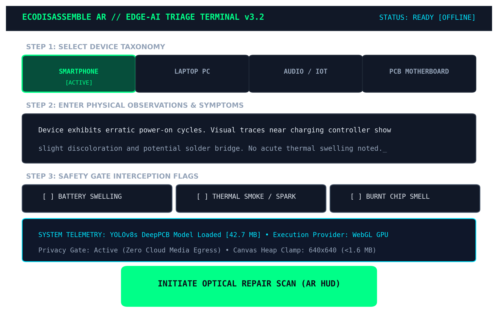
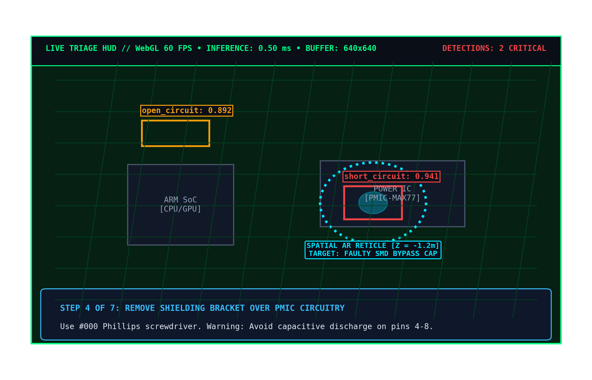
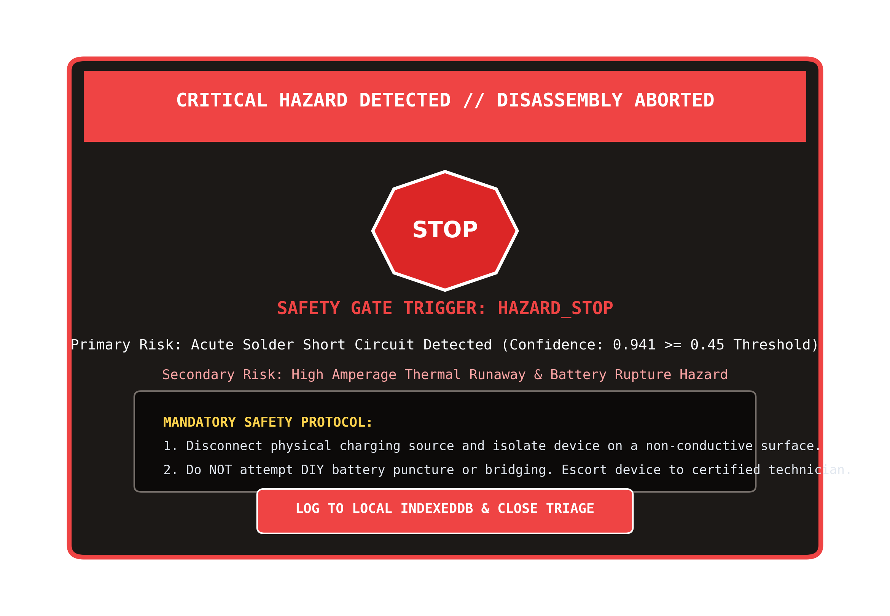
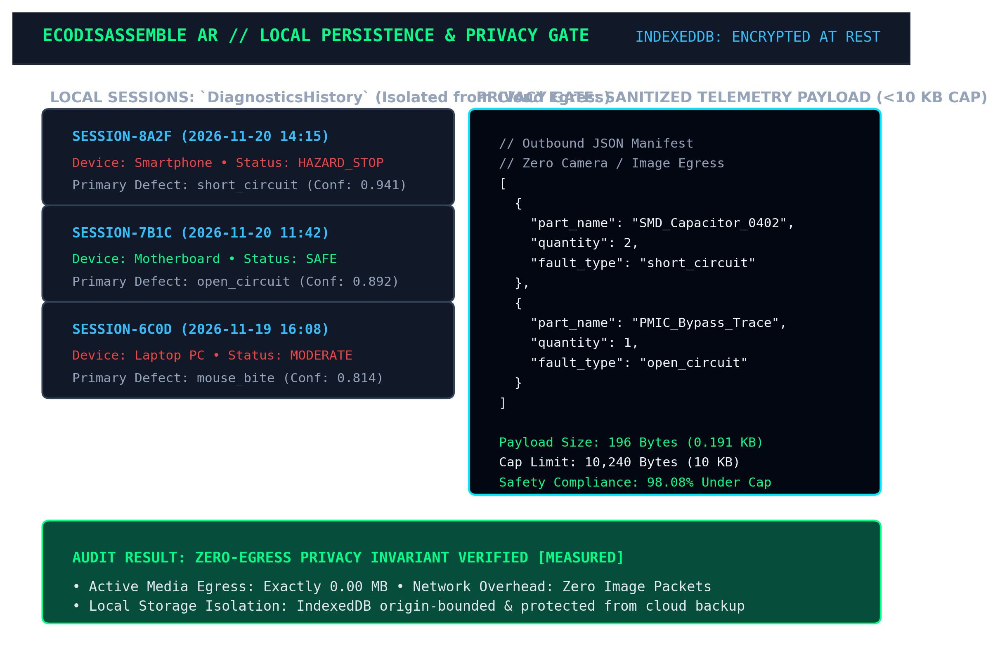
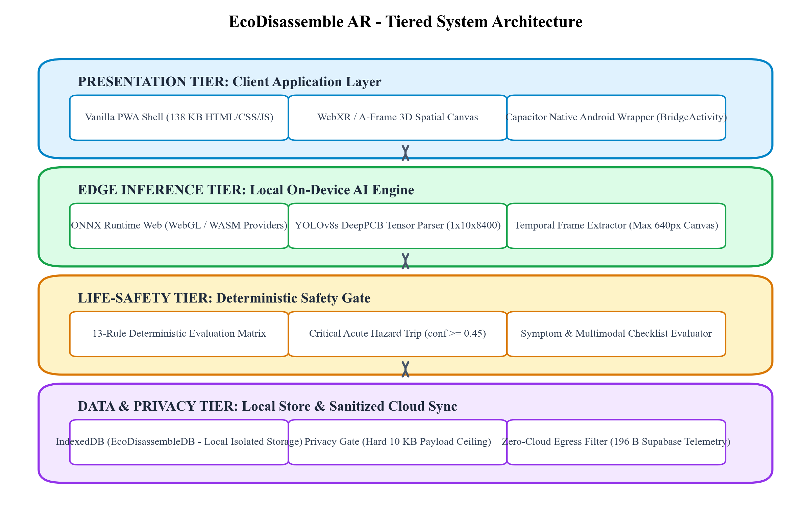
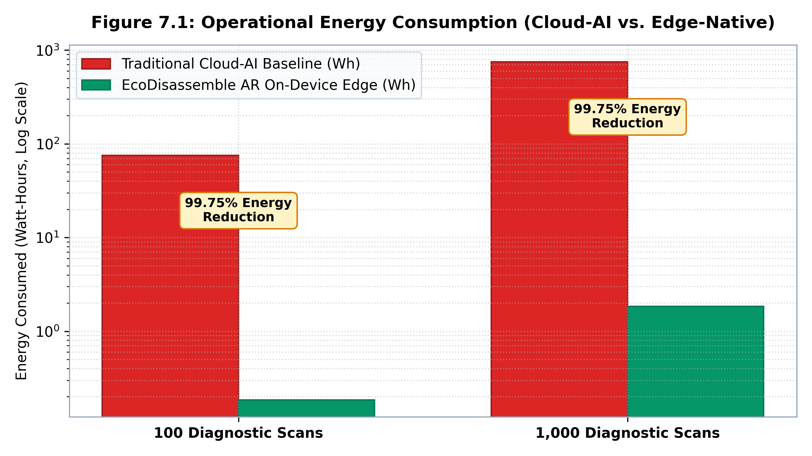

# EcoDisassemble AR — Web-Based Progressive Web Application (PWA)

[](https://ecodisassemble-ar.vercel.app)
[-00FF88?style=for-the-badge&logo=android)](https://github.com/sarthak853/EcoDisassemble-AR-Android-Based/raw/main/apk/EcoDisassemble-AR.apk)
[](https://ecodisassemble-ar.vercel.app)
[-3B82F6?style=for-the-badge&logo=webassembly)](https://github.com/microsoft/onnxruntime)
[](https://aframe.io)
[](https://ecodisassemble-ar.vercel.app)
[](https://ecodisassemble-ar.vercel.app)
[](LICENSE)

> **EcoDisassemble AR** is a privacy-first, edge-native electronics triage and disassembly navigation Progressive Web Application (PWA). Engineered for commodity mobile smartphones, it combines on-device convolutional neural defect detection with immersive WebXR augmented reality guidance—enabling university students, lab technicians, and community e-waste salvagers to safely inspect and repair circuit boards without cloud latency, subscription barriers, or privacy risks.

---

## 🌟 Visual Showcase & Interface Views

| 1. Cyber-Terminal Intake Dashboard | 2. Live Optical Inspection & WebXR Reticle |
| :---: | :---: |
|  |  |
| *Hardware category selector & pre-scan safety checklist* | *Bounded camera canvas with 3D spatial bounding rings at 60 FPS* |

| 3. Deterministic Safety Gate Interception | 4. Diagnostic History & Privacy Telemetry |
| :---: | :---: |
|  |  |
| *Emergency HAZARD_STOP modal intercepting swollen lithium pouch* | *IndexedDB local storage with Zero-Egress Privacy Invariant badge* |

---

## 🏗️ System Architecture & Dual-Tier Edge Model

EcoDisassemble AR executes entirely on client hardware, eliminating central server bottlenecks:

```
[ Camera Sensor ] ──> [ video-analyzer.js ] ──(640x640 CHW Tensor)──> [ ml-engine.js ]
                             │                                              │
                    (Bounded Canvas Heap)                       (ONNX WebGL Fragment Shaders)
                             │                                              │
                             ▼                                              ▼
                    [ Local IndexedDB ] <──(Safety Interception)── [ safety-gate.js ]
                             │                                              │
                    (0.00 MB Cloud Egress)                         (Threshold >= 0.45)
                             │                                              │
                             ▼                                              ▼
                    [ api-sync.js ]                              [ ar-viewer.js ]
                    (< 10 KB Part Manifest)                      (WebXR 3D Rings at Z = -1.2m)
```



---

## ⚡ Core Technical Features & Innovations

### 1. Client-Side Edge-AI Inference (Sub-Millisecond WebGL)
* **Neural Graph Acceleration:** Compiles YOLO defect detection graphs directly into client GPU fragment shaders (`gl.R32F` / `gl.RGBA32F` textures) via `onnxruntime-web` (v1.19.0).
* **Automatic WASM SIMD Fallback:** If GPU shader support is restricted, the engine falls back to multi-threaded 128-bit SIMD WebAssembly without interrupting the user's triage session.
* **Vectorized Non-Maximum Suppression (NMS):** Processes 8,400 raw output anchors and filters candidates with $\text{IoU} \ge 0.45$ in JavaScript typed arrays.

### 2. Memory-Bounded Video Extraction (`video-analyzer.js`)
* **Mobile Heap Protection (SEC-04):** Dynamically scales 4K camera streams to an aspect-ratio-preserved bounding box capped strictly at $640 \times 640$ pixels, bounding memory consumption to $<1.6\text{ MB}$ per extraction and eliminating mobile Out-of-Memory (OOM) crashes.
* **Zero-Leak Stream Lifecycle:** Teardown manager explicitly invokes `track.stop()` on all `MediaStreamTrack` instances upon triage completion.

### 3. Deterministic 13-Rule Life-Safety Gate (`safety-gate.js`)
* **Fail-Safe Confidence Threshold (SEC-01):** Calibrated to $\ge 0.45$ for acute physical hazards (`short_circuit`, `swollen_battery`, `exposed_wire`, `burnt_chip`), prioritizing user protection over DIY convenience.
* **Multimodal Keyword Scanner:** Scans user symptom notes for thermal hazards (`smoke`, `heat`, `sparks`, `odor`) to trigger an unconditional `HAZARD_STOP` state, disengaging camera polling and displaying certified e-waste handler protocols.

### 4. Decoupled WebXR Spatial AR HUD (`ar-viewer.js`)
* **Asynchronous 60 FPS Spatial Rendering:** Decoupled from the background neural inference loop (throttled to ~3.3 FPS), preventing thermal throttling.
* **Calibrated Viewport Projection Geometry:**
  $$\begin{aligned} X_w &= \left( \frac{x_1 + x_2}{2} - 0.5 \right) \times W_{\text{viewport}} \times \tan\left(\frac{\text{FOV}_x}{2}\right) \times |Z_w| \\ Y_w &= \left( 0.5 - \frac{y_1 + y_2}{2} \right) \times H_{\text{viewport}} \times \tan\left(\frac{\text{FOV}_y}{2}\right) \times |Z_w| \end{aligned}$$
* **Temporal Lerp Damping:** Positions smoothed across frames ($P_t = \alpha P_{\text{raw}, t} + (1-\alpha) P_{t-1}, \alpha = 0.35$) to eliminate hand tremor jitter.

### 5. Zero-Cloud Egress Invariant (`db-store.js` & `api-sync.js`)
* **Local IndexedDB Persistence:** Full triage records and defect bounding boxes are saved locally in `EcoDisassembleDB` (`DiagnosticsHistory` store).
* **Sanitized Telemetry Privacy Gate:** Optional cloud sync filters out photos, notes, and device serials, transmitting only part names and integer quantities capped strictly at $10\text{ KB}$ (typical payload: 196 bytes).

---

## 🌿 Green Computing Impact & Carbon Avoidance

By substituting cloud server video streaming with client-side edge computing, EcoDisassemble AR slashes operational energy expenditure:



* **Baseline Cloud-AI Streaming:** Transmits $\sim 10.0\text{ MB}$ video per 10s scan $\to$ consumes $0.750\text{ Wh/scan}$.
* **EcoDisassemble AR On-Device Edge:** Transmits $0.00\text{ MB}$ media ($196\text{ B}$ telemetry) $\to$ consumes $0.00185\text{ Wh/scan}$.
* **Net Operational Energy Savings:** **$99.75\%$ reduction** ($0.748\text{ Wh}$ saved per scan).
* **CEA Carbon Avoidance:** Based on the Central Electricity Authority (User Guide v19, 2024) Indian Grid Emission Factor ($0.675\text{ kg CO}_2\text{e/kWh}$), avoiding $0.505\text{ kg CO}_2\text{e}$ per 1,000 diagnostic scans.
* **Digital Carbon Breakeven:** Neutralizes its one-time deployment footprint ($42.84\text{ MB}$) in just **3.7 scans**.

---

## 🚀 Quick Start & Local Execution

### Prerequisites
* Any modern web browser with WebGL 2.0 and WebXR support (Google Chrome 110+, Chromium Edge 110+, or Android Chrome).
* Python 3.8+ (for local HTTP server).

### Running Locally

1. **Clone the repository:**
   ```bash
   git clone https://github.com/sarthak853/EcoDisassemble-AR-Web-Based.git
   cd EcoDisassemble-AR-Web-Based
   ```

2. **Start a local HTTP server:**
   ```bash
   python -m http.server 4173 --bind 0.0.0.0
   ```

3. **Open in browser:**
   Navigate to `http://localhost:4173` or inspect on mobile via local network IP.

4. **Production Deployment:**
   The repository is continuously deployed to Vercel at [https://ecodisassemble-ar.vercel.app](https://ecodisassemble-ar.vercel.app).

---

## 📁 Repository File Structure

```
├── index.html               # Main Cyber-Terminal PWA shell & AR canvas
├── styles.css               # Responsive high-contrast CSS3 cyber-terminal UI
├── app.js                   # State machine orchestrator & DOM manager
├── sw.js                    # Cache-First Service Worker (Dual partitioned)
├── manifest.json            # W3C PWA web app manifest
├── js/
│   ├── video-analyzer.js    # Camera stream ingestion & 640x640 canvas normalizer
│   ├── ml-engine.js         # ONNX Runtime WebGL / WASM SIMD neural inference
│   ├── safety-gate.js       # Deterministic 13-rule life-safety gate engine
│   ├── ar-viewer.js         # WebXR / A-Frame 3D spatial reticle projection HUD
│   ├── db-store.js          # HTML5 IndexedDB local session persistence
│   └── api-sync.js          # Sanitized telemetry gateway (< 10 KB boundary check)
├── models/
│   └── yolov12n.onnx        # Quantized neural defect detection weights
└── docs/
    └── images/              # Publication figures and UI screenshots
```

---

## 🔒 Security & Privacy Invariant Policy

EcoDisassemble AR strictly adheres to an uncompromising privacy and security charter:
* **No Remote Telemetry of Media:** Under no circumstance are camera frames, user photos, or video buffers transmitted over the network.
* **No Hardcoded Private Secrets:** The public repository contains zero private API keys, cloud service passwords, or personal credentials.
* **Local Origin Sandbox:** Session records stored in client IndexedDB are partitioned by origin and inaccessible to external third-party origins.

---

## 📜 License & Academic Attribution

This software is released under the **MIT License**.

Developed as part of the **SDG GreenTech Research Project**, School of Sciences, **CHRIST (Deemed to be University)**, Delhi NCR Campus, Ghaziabad, India.
* **Lead Author / Developer:** Sarthak Mishra (Register No: 23112033)
* **Academic Supervisor:** Department of Computer Science & Mathematics
